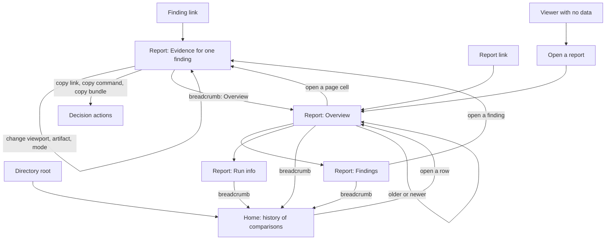

# Viewer workflow and navigation map

Status: design authority for issue #148. The specification (R10.3 to R10.5, R10.10, R10.13 to R10.15) adopts it, except the open points below. It is not yet the state of `frontend/`. A change to a rule or a path in this file is Tier 3. A record of an approved decision is Tier 1 (`docs/vision.md`, Design authority, rule 6). It is a target, not the current state. It differs from R10.3 (collapsible left column), R10.4 (views: target detail, matrix, findings, timeline, speed, content) and R10.5 (first view by pair kind). The proposed Overview, Evidence, Findings and Run info replace them only after the owner approves a specification change. It serves principles 1, 2 and 3 of `docs/vision.md` (V1 to V4 in `PRODUCT.md`) and R10.1, R10.11, R10.13. It is not a requirement until the specification adopts it. Sample data comes from `example-site`.

## Who uses the viewer

| Reader | Situation | Job | What goes wrong today |
| --- | --- | --- | --- |
| Developer (primary) | Gets a link from an agent, a task or a colleague. Opens it in a desktop browser. | See the exact finding. Decide: fix, mark as a known difference, mark as noise, pass it on. | The link opens a report, not the finding. The report title is always "before → after". The capture date sits inside a closed "Capture details". |
| Project lead (secondary) | Opens the home to check the state of the latest run. | Answer "is the latest run clean, and what changed since the last one?" | The list has no verdicts. The answer needs two reports opened. |
| Agent | Reads bounded JSON (`summary`, `query`, `report.json`). | Find a difference, verify it, fix it, measure again. | Not a viewer user. The viewer must not change this interface. |

## Entry points

1. **Finding link.** The developer opens a link to one finding. The page shows that finding with the same view state as the sender. This is the main entry.
2. **Report link.** A link to one comparison opens its Overview.
3. **Directory root.** The publish directory opens the Home (history of comparisons).
4. **Viewer with no data.** The viewer loads the adjacent `report.json` first. Only on a 404 does it read `index.json` (R10.13). When both are missing, it shows an empty state, "Open a report", with the source form of R10.10. This is the only place that asks for a file or a URL. A viewer copy with an adjacent `report.json` (a `report --export` directory) opens that report directly and has no Home.

## Map

## Rules for every path

- One way home: the breadcrumb, always first in the content column.
- One way sideways: older and newer comparison, in time order.
- One way up: from Evidence, the breadcrumb returns to the Overview with the same filter.
- Browser Back steps through views. A view change adds a history entry.
- The app never changes the active view without saying why.

## Decision actions

On a finding the page shows four labelled actions: Fix (copy the link), Known difference (copy the command), Noise or unstable (not defined yet) and Pass on (copy the link). Decided by the owner on 2026-10-20 (#153, D15).

The viewer is a static application. It cannot run a command or write a file. A decision action therefore produces text for the person to use:

| Decision | What the viewer offers | What exists today |
| --- | --- | --- |
| Fix | Copy the link. The task or the agent gets the same view. | The link holds only `#r-<id>`. |
| Known difference | Copy the command `test-kit record-known REPORT --config FILE --target ID --viewport ID --artifact screenshot|html|content --cause ID --reason TEXT` with the report, target, viewport and artifact filled in. The person adds the cause and the reason and runs it. R5.3 and R11.5 say recording must not be a viewer action: copying text does not record anything. | The command exists. The viewer does not build it. |
| Noise or unstable | Not defined. A noise floor is measured per pair (R8.3). What a mark stores is an owner decision. | None. |
| Pass on | Copy the link. Later: an evidence bundle (issue #149). | None. |

## Deep link grammar (proposal)

`#r-<report id>/<view>/<target id>/<viewport id>/<artifact>?mode=<mode>`

- `view`: `overview`, `evidence`, `findings`, `info`.
- A missing part falls back to the first valid value. An unknown value shows a message and the Overview. The viewer validates every part as an identifier before it reads a path (report data is untrusted).
- The hash stays under the page origin. It never carries a URL.

## Open points for the owner

- What "mark as noise or unstable" stores, and where.
- Whether the viewer builds the `record-known` command text, or only links to the documentation. R5.3 allows text but forbids a viewer action that records.
- Which of R10.3, R10.4 and R10.5 change, and the specification edit that does it.
- The grammar above, before it enters the specification.
