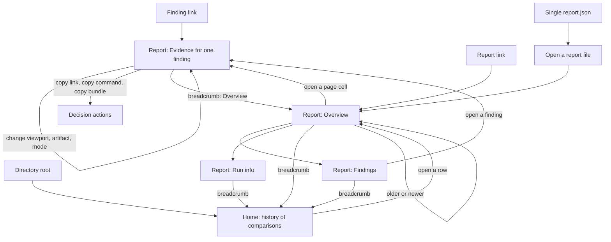

# Viewer workflow and navigation map

Status: proposal for issue #148. It serves principles 1, 2 and 3 of `docs/vision.md` and R10.1, R10.11, R10.13. It is not a requirement until the specification adopts it. Sample data comes from `example-site`.

## Who uses the viewer

| Reader | Situation | Job | What goes wrong today |
| --- | --- | --- | --- |
| Developer (primary) | Gets a link from an agent, a task or a colleague. Opens it in a desktop browser. | See the exact finding. Decide: fix, mark as a known difference, mark as noise, pass it on. | The link opens a report, not the finding. The page does not say which run it is. |
| Project lead (secondary) | Opens the home to check the state of the latest run. | Answer "is the latest run clean, and what changed since the last one?" | The list has no verdicts. The answer needs two reports opened. |
| Agent | Reads bounded JSON (`summary`, `query`, `report.json`). | Find a difference, verify it, fix it, measure again. | Not a viewer user. The viewer must not change this interface. |

## Entry points

1. **Finding link.** The developer opens a link to one finding. The page shows that finding with the same view state as the sender. This is the main entry.
2. **Report link.** A link to one comparison opens its Overview.
3. **Directory root.** The publish directory opens the Home (history of comparisons).
4. **Single file.** A `report.json` with no `index.json` opens an empty state, "Open a report file". This is the only place that asks for a file or a URL.

## Map

## Rules for every path

- One way home: the breadcrumb, always first in the content column.
- One way sideways: older and newer comparison, in time order.
- One way up: from Evidence, the breadcrumb returns to the Overview with the same filter.
- Browser Back steps through views. A view change adds a history entry.
- The app never changes the active view without saying why.

## Decision actions

The viewer is a static application. It cannot run a command or write a file. A decision action therefore produces text for the person to use:

| Decision | What the viewer offers | What exists today |
| --- | --- | --- |
| Fix | Copy the link. The task or the agent gets the same view. | The link holds only `#r-<id>`. |
| Mark as a known difference | Copy the `record-known` command with the target, viewport, artifact and cause filled in. The person adds the reason and runs it. | The command exists. The viewer does not build it. |
| Mark as noise or unstable | Not defined. A noise floor is measured per pair (R8.3). What a mark stores is an owner decision. | None. |
| Pass it on | Copy the link. Later: an evidence bundle (issue #149). | None. |

## Deep link grammar (proposal)

`#r-<report id>/<view>/<target id>/<viewport id>/<artifact>?mode=<mode>`

- `view`: `overview`, `evidence`, `findings`, `info`.
- A missing part falls back to the first valid value. An unknown value shows a message and the Overview. The viewer validates every part as an identifier before it reads a path (report data is untrusted).
- The hash stays under the page origin. It never carries a URL.

## Open points for the owner

- What "mark as noise or unstable" stores, and where.
- Whether the viewer builds the `record-known` command text, or only links to the documentation.
- The grammar above, before it enters the specification.
